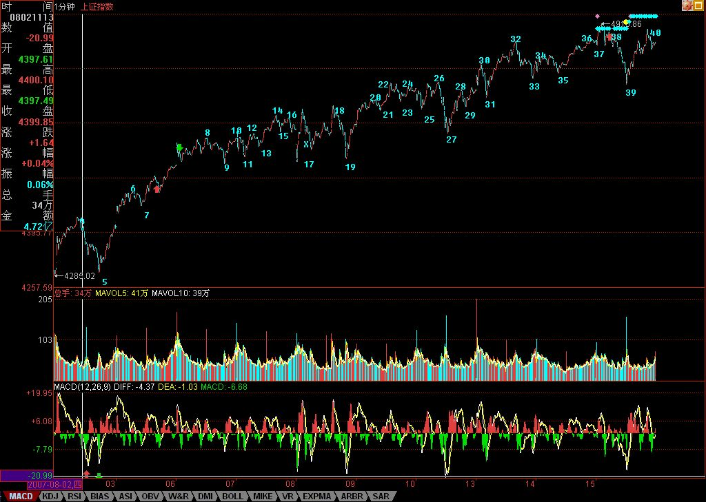
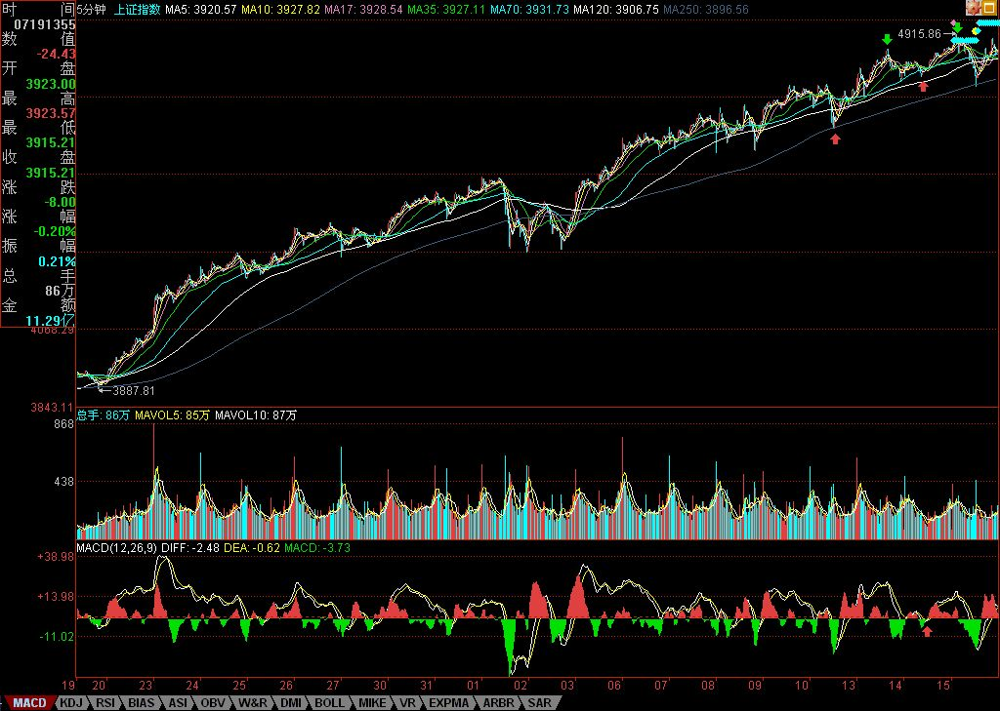

来源：https://chanlunzhan.com/108/70
采集时间：2026-11-08T02:33:38+08:00
资料层：本站转载与导读，未经逐字原版校勘
归档范围：静态正文与链接；交互图表、测验状态与浏览器学习进度未离线复现。

- [首页](https://chanlunzhan.com/)

- [108 课原文](https://chanlunzhan.com/108)

- 第 70 课

第 70 课2007-08-15·[阶段 6 三类买卖点](https://chanlunzhan.com/learn/maimaidian)

# 教你炒股票70：一个教科书式走势的示范分析

导读

写于 2007-08-15，篇幅适中（约 1700 字）。正文集中出现的概念是走势中枢、级别、趋势、走势类型、第三类买卖点。按本站的编排，它属于阶段 6「三类买卖点」。能在历史图上标出三类买卖点的位置——如果读起来吃力，多半是这一阶的基础还没打牢，建议先看对应的讲义再回来。原文配有 2 张图，图是理解这一课的关键，不要跳过。

# 0637 - 教你炒股票70：一个教科书式走势的示范分析

日期：(2007-08-15 22:41:35) 分类：[时政经济（缠中说禅经济学）]

首先，今天下午太匆忙，37后就直接标记39，晚上回来才发现，已经改过来。

在前面的课程里，本ID反复说过，结合律是至关重要的。这里的人，认真学过抽象代数的人少，所以不大明白运算规则的选择对研究对象的决定性意义。对于走势来说，结合律就是连接走势之间关系最重要的规则，不深切明白这一点，如何能明白走势本身？

无论如何结合，本ID的理论对走势的分析原则是不变的。可以这样认为，本ID的理论，就是走势保持结合律下具有变换不变性的一套理论，而且可以严格地证明，是唯一能保持分解变换不变且保持结合律的一套理论。如果有点现代数学常识，对这理论的意义应该能多点了解。

这几天，随着走势的当下发展，本ID不断变换着所看的[中枢](https://chanlunzhan.com/glossary/zhongshu)，这根本的原因就在于结合律，因为结合律，我们可以对走势进行最有利观察的分解，这样，才能更容易明白走势究竟在干什么？

例如，到今天，走势一种最明显的划分已经自动走出来，就是8-17构成5分钟中枢，该中枢是4300点那个5分钟中枢上来后的一个新的5分钟中枢，这个中枢，在刚形成时，我们已经指出，而且任何学过本ID理论的，都可以当下指出。一般来说，形成这个5分钟中枢后，在理论上只有三种走势：

1：向上出现第三类买点，走出1分钟向上[走势类型](https://chanlunzhan.com/glossary/zoushileixing)，然后构成新的5分钟中枢；
2、向下出现第三类卖点，走出1分钟线向下走势类型，构成新的5分钟中枢。
3、[中枢延伸](https://chanlunzhan.com/glossary/zhongshuyanshen)，或出现[第三类买卖点](https://chanlunzhan.com/glossary/disanleimaimaidian)后扩展成大[级别](https://chanlunzhan.com/glossary/jibie)的30分钟中枢。

显然，在行情发展中，没必要去预测走势选择什么，走势自然选择，只需要观察着就可以。现在，走势自然选择了第一种，为什么？因为17-38构成完美的1分钟[上涨](https://chanlunzhan.com/glossary/qushi)走势，目前，围绕这1分钟上涨走势的最后一个1分钟中枢32-35，正扩展出新的5分钟中枢的雏形。

这个5分钟中枢，最终至少要完成的，至于是否继续扩展出大的30分钟中枢，还是出现新5分钟中枢的第三类买点继续上涨，再形成新的5分钟中枢，这无须预测，与8-17那5分钟中枢一样对待，如此而已。

那么，如果是按30分钟操作的，这些5分钟的中枢移动、震荡之类的活动根本无须理睬，只要看明白就是，根本无须操作；如果是按5分钟级别操作，那么就是不参与大于5分钟级别的震荡，那么就等5分钟上涨出现[背驰](https://chanlunzhan.com/glossary/beichi)后走人；如果是按1分钟级别操作，那么今天早上就该先走，为什么？因为1分钟的上涨出现背驰，按照本ID的理论，后面必然回抽到最后一个1分钟的中枢之内，从而至少形成一个新的5分钟中枢。然后根据5分钟震荡的走势进行回补就可以。

注意，按照多样性分解原则，新的5分钟中枢，暂时先从最后一个1分钟中枢开始算起，后面的操作先以此为准，等走势走出最自然的选择再继续更合理的划分。按照这暂时的划分，并不影响任何操作，5分钟中枢该怎么操作就怎么操作，如此而已。

在今天的背驰判断中，关键是知道哪一段相比，显然，27-32与35-38这两段去比。而实际的对比中，看1分钟图，去加两段对应的那些[MACD](https://chanlunzhan.com/glossary/macd)，太麻烦，所以可以看5分钟图。这里，把5分钟图给放上来了，图上，相应对比的两段已经标记出来，下面MACD的红箭头，对应是回抽那一下，对应走势，就是最后一个1分钟中枢形成的时候，前面两段的对比，极为教科书，请好好揣摩。

其实，只要基本概念明确，这些分析，在当下都不是什么难事。这里必须提醒一下，1分钟图上38标记的位置用红箭头给出，显然，那不是最高的位置。为什么？没有人规定分段的结束位置一定是最高、最低的，关键要有至少三[笔](https://chanlunzhan.com/glossary/bi)，因为从37开始到最高的位置，没有三笔，所以不能认为[线段](https://chanlunzhan.com/glossary/xianduan)已经完成。但在1分钟级别上看，那么37-38这一段，就结束在最高的位置，为什么？线段的存在，是为了让图形规范化，就如同在5分钟中枢里，看1分钟走势类型的重叠，是把整个走势类型的波动区域算在一起看，道理是一样的。

本文评论获取自靠谱的方式，包含疑似禅师的回复数[量](https://chanlunzhan.com/glossary/chengjiaoliang)：[0]

原文作者：缠中说禅（李彪）。本站为学习用途引用，版权归原作者所有。
[阅读新浪博客原文 ↗](https://blog.sina.com.cn/s/blog_486e105c01000c86.html)

## 本课术语

- [走势中枢](https://chanlunzhan.com/glossary/zhongshu)

- [级别](https://chanlunzhan.com/glossary/jibie)

- [趋势](https://chanlunzhan.com/glossary/qushi)

- [走势类型](https://chanlunzhan.com/glossary/zoushileixing)

- [第三类买卖点](https://chanlunzhan.com/glossary/disanleimaimaidian)

- [背驰](https://chanlunzhan.com/glossary/beichi)

- [线段](https://chanlunzhan.com/glossary/xianduan)

- [MACD](https://chanlunzhan.com/glossary/macd)

[← 上一篇

教你炒股票69：月线分段与上海大走势分析、预判](https://chanlunzhan.com/108/69)[下一篇 →

教你炒股票71：线段划分标准的再分辨](https://chanlunzhan.com/108/71)
