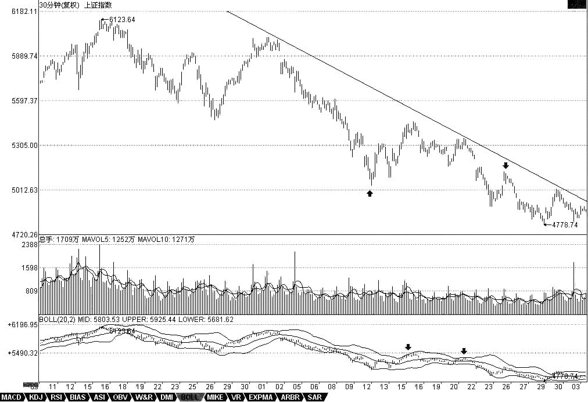

来源：https://chanlunzhan.com/108/90
采集时间：2026-11-08T02:33:46+08:00
资料层：本站转载与导读，未经逐字原版校勘
归档范围：静态正文与链接；交互图表、测验状态与浏览器学习进度未离线复现。

- [首页](https://chanlunzhan.com/)

- [108 课原文](https://chanlunzhan.com/108)

- 第 90 课

第 90 课2007-12-03·[阶段 7 递归与联立](https://chanlunzhan.com/learn/recursion)

# 教你炒股票90：中阴阶段结束时间的辅助判断

导读

写于 2007-12-03，篇幅很短（约 1300 字）。正文集中出现的概念是三类买卖点、第二类买卖点、级别、第一类买卖点、趋势。按本站的编排，它属于阶段 7「递归与联立」。拿到一张陌生的完整走势图，能自上而下做完整分解并写出结构说明——如果读起来吃力，多半是这一阶的基础还没打牢，建议先看对应的讲义再回来。原文配有 1 张图，图是理解这一课的关键，不要跳过。

# 0800 - 教你炒股票90：中阴阶段结束时间的辅助判断

日期：(2007-12-03 22:33:08) 分类：[时政经济（缠中说禅经济学）]

注意，这里给出的是中阴阶段结束时间的辅助判断，并不是一个绝对性的判断，如同用[MACD](https://chanlunzhan.com/glossary/macd)判断[背驰](https://chanlunzhan.com/glossary/beichi)一样，只是一个辅助性，但由于准确率极高，绝对的判断反而因为太复杂而不实用，所以就可以一般性地利用这进行判断。一般来说，这个中阴阶段结束时间的辅助判断的有效性可以达到接近100%，很少有例外。

当然，由于是辅助性判断，所以技巧性与熟练程度就很关键了。这就如同玩杂技，训练有素的上台出错的几率很小，而一个训练都没有的一上台肯定出错。

这个辅助判断，可以利用所有软件都有的一个指标：布林通道。一般在软件上都用BOLL表示。该指标一般都三条线，上、中、下三个轨道。一般性地，在上轨以上和下轨以下运行是超强状态，一般[中枢](https://chanlunzhan.com/glossary/zhongshu)移动时肯定会出现，唯一区别是前者是[上涨](https://chanlunzhan.com/glossary/qushi)超强，后者是下跌超强。

注意，用这个指标有一个很好的辅助判断[第二类买卖点](https://chanlunzhan.com/glossary/dierleimaimaidian)，有时候也可以用来判断[第一类买卖点](https://chanlunzhan.com/glossary/diyileimaimaidian)。一般来说，从上轨上跌回其下或从下轨下涨回其上，都是从超强区域转向一般性区域，这时候，如果再次的上涨或回跌创出新高或新低但不能重新有效回到超强区域，那么就意味着进入中阴状态了，也就是第一类买卖点出现了。

但更有效的是对第二[买卖点](https://chanlunzhan.com/glossary/sanleimaimaidian)的辅助判断，一般来说，在进入中阴状态，上轨和下轨都会滞后反应，也就是等第一次回跌或回升后再次向上或下跌时，上轨和下轨才会转向，而这时候转向的上轨和下轨，往往成为最大的阻力和支持，使得第二类买卖点在其下或其上被构造出来。一个例子，就是上海大盘在6004点时构成的第二类卖点，还有一个例子就是6月20日那天的第二类买卖点。

个股方面，000938是一个经典的例子，9月14日的第一类卖点，10月8日的第二类卖点，太教科书了。000999的10月10日的第一类卖点以及11月6日的第二类卖点，也同样教科书。这些例子太多，而且在不同的[级别](https://chanlunzhan.com/glossary/jibie)中都一样有效。

注意，有人可能说本ID上面那两个例子都是自己的股票，那肯定对。其实，别的股票更准确，例如000002，这股票够大众情人了，请看他的周线，40.78元那周，看看究竟发生了什么事竟然构成了周线的第一卖点？

不过，布林通道最有用的，还是关于中阴结束时间的预判上。一般来说，布林通道的收口，就是对中阴结束时间的最好提示。但这里有一定的技巧性，不是1分钟级别就一定要看1分钟的布林通道的，例如下图，一个5分钟的中阴过程，对应的是看30分钟的布林通道。

一般来说，某一级别的布林通道收口，就意味着比这低级别的某个中阴过程要级别扩展或结束了，一般都对应着有相应的[第三类买卖点](https://chanlunzhan.com/glossary/disanleimaimaidian)。

下图这个例子请好好研究一下，里面还有下午说的那条下降通道，可以看到，现在离这个上轨有多接近。

注意，这个辅助判断，比MACD那个技巧性还要高点，必须不断看图，自己去总结自己的经验才会有所得。本ID这里只是把月亮指给各位，要把月亮变成自己的，还需要自己去努力。

​    【编者注：此图可能是当时的网友补充的】

【编者注：本课原文，全文都是红色字体的】

本文评论获取自靠谱的方式，包含疑似禅师的回复数[量](https://chanlunzhan.com/glossary/chengjiaoliang)：[0]

原文作者：缠中说禅（李彪）。本站为学习用途引用，版权归原作者所有。
[阅读新浪博客原文 ↗](https://blog.sina.com.cn/s/blog_486e105c01000eor.html)

## 本课术语

- [三类买卖点](https://chanlunzhan.com/glossary/sanleimaimaidian)

- [第二类买卖点](https://chanlunzhan.com/glossary/dierleimaimaidian)

- [级别](https://chanlunzhan.com/glossary/jibie)

- [第一类买卖点](https://chanlunzhan.com/glossary/diyileimaimaidian)

- [趋势](https://chanlunzhan.com/glossary/qushi)

- [MACD](https://chanlunzhan.com/glossary/macd)

- [走势中枢](https://chanlunzhan.com/glossary/zhongshu)

- [背驰](https://chanlunzhan.com/glossary/beichi)

[← 上一篇

教你炒股票89：中阴阶段的具体分析](https://chanlunzhan.com/108/89)[下一篇 →

教你炒股票91：走势结构的两重表里关系1](https://chanlunzhan.com/108/91)
